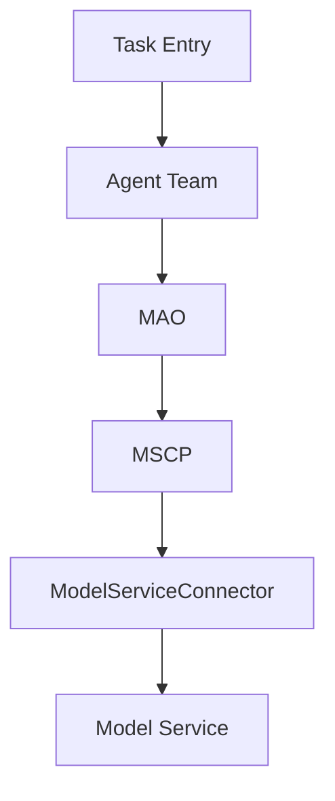

# Model Access Object

`model-access-object` provides an application-facing model access layer for
agentic systems.

It is designed to work with a Model Service Connector Pool (MSCP), but its
responsibility is different:

- Agent Teams manage business workflows.
- MAO translates business model-access needs into model-access requests.
- MSCP manages model service connector acquisition, leasing, routing, and
  release.

## Why

In traditional Spring-style information systems, the application service or
manager layer should not directly handle database connection details. Instead,
it calls DAO objects, and DAO objects rely on connection pools such as DBCP or
HikariCP.

Agentic applications need a similar layer:

| Spring Information System | Agentic Intelligent System |
| --- | --- |
| Controller | Task/API entry |
| Manager / Service | Agent Team / Task Orchestrator |
| DAO | MAO: Model Access Object |
| DBCP / HikariCP | MSCP: Model Service Connector Pool |
| JDBC Driver | Model Connector / Adapter |
| Database | Model Service / LLM Endpoint |

## Architecture



## Core Idea

Agent Team code should express business intent:

```python
response = await mao.chat(
    agent_id="writer-01",
    role="writer",
    task_type="proposal_writing",
    messages=[{"role": "user", "content": "Draft the project summary."}],
)
```

MAO maps this request into a model capability requirement and delegates the
actual connector acquisition to MSCP.

## Documentation

- [Concepts](docs/concepts.md)
- [Usage Guide](docs/usage.md)
- [API Reference](docs/api.md)
- [Roadmap](ROADMAP.md)

## License

Apache-2.0
